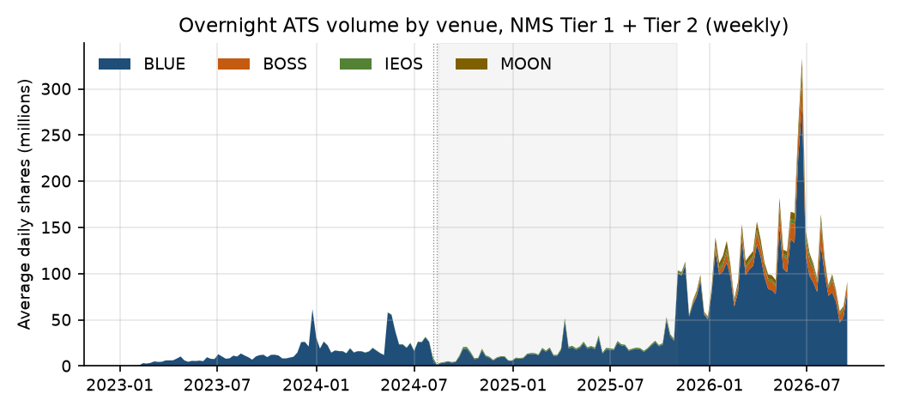
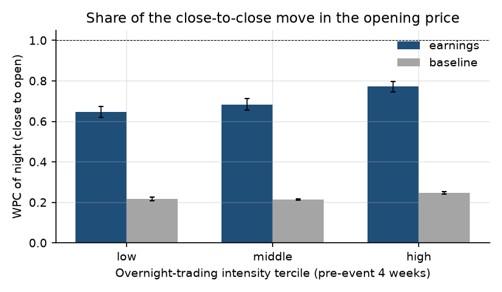

# Who prices the stock when the exchange is closed? Overnight ATS trading and price discovery around earnings

*Independent research on public data (FINRA, Cboe, Yahoo Finance). No CAT or other non-public
data. All results are associations. Code and data lineage: this repository.*

## 1. Question

Trading in US NMS stocks between 8 pm and 4 am ET now runs every weeknight on four
overnight-only alternative trading systems. The SEC staff's September 2026 memo for the 24-hour
trading roundtable documents how much trades overnight and who trades, but does not ask what
overnight trading does for prices. This note asks two questions with public data:

1. **Which stocks trade overnight?** How large, how concentrated and how fast-growing is the
   overnight session, and which stock characteristics go with a higher overnight share?
2. **Is more overnight trading associated with better price discovery?** After an earnings
   announcement released after the close, does the next morning's opening price capture more of
   the information in stocks that trade more overnight?

## 2. Data

**Overnight volume.** FINRA publishes weekly volume by symbol for every ATS (Rule 4552). Four
ATSs operate only overnight: Blue Ocean (BLUE), Bruce (BOSS), IBKR Eos (IEOS) and MOON; their
operating hours are taken from each venue's Form ATS-N. Their weekly volume is overnight volume.
MOON opens at 7:30 pm and IBKR Eos at 6 pm on holiday evenings, so the measure slightly overstates
8 pm-4 am trading. Non-ATS overnight trading (a material part of overnight volume in the SEC
memo's Table 1) is not public by session and is excluded throughout.

**Other sources.** Cboe's consolidated U.S. equities volume files give total NMS share and dollar
volume by day (source: Cboe Exchange, Inc.). FINRA's daily Reg SHO files give off-exchange
short-sale volume. Yahoo Finance gives daily prices and earnings dates with announcement times.
The store holds 17,422,567 rows, including 950,525 overnight-venue symbol-week records.
Before use, the FINRA pulls were checked for truncation and internal consistency (symbol rows sum
to venue totals in all 1,082 cached venue-week-tier totals) and the earnings timing flags were
checked against returns (15.4% of 17,837 after-close events have a larger move in the
night before the announcement than after it; these are dropped from the event study).

**Sample.** Market-level facts use NMS Tier 1 + Tier 2 for the 194 weeks from
2023-01-02 to 2026-09-14. The stock-level analyses use Tier 1 only (S&P 500, Russell 1000
and selected exchange-traded products), where prices and earnings data are cleaner.

**Tier coverage.** Tier 2 stocks carry most overnight *share* volume but Tier 1 carries most
overnight *dollar* volume (table below). The market-level facts and the reconciliation to the
SEC staff memo use Tier 1 + Tier 2. The stock-level analyses use Tier 1 only, so they describe
Tier 1 stocks, not the overnight market as a whole.

<!-- BEGIN GENERATED:coverage -->
Tier 1 share of overnight-ATS volume (A2 and A3 use Tier 1 only; A1 uses both tiers). Source: `reports/tables/a1_tier_coverage.csv`.

| Period | Venue | Tier 1 share of shares | Tier 1 share of dollars |
|---|---|---|---|
| full sample (both-tier weeks) | BLUE | 14.2% | 62.4% |
| full sample (both-tier weeks) | BOSS | 17.9% | 63.7% |
| full sample (both-tier weeks) | IEOS | 23.9% | 69.1% |
| full sample (both-tier weeks) | MOON | 11.9% | 54.6% |
| full sample (both-tier weeks) | ALL | 14.7% | 62.7% |
| 2026-08 (complete weeks) | BLUE | 15.6% | 62.3% |
| 2026-08 (complete weeks) | BOSS | 22.2% | 65.7% |
| 2026-08 (complete weeks) | IEOS | 22.9% | 66.9% |
| 2026-08 (complete weeks) | MOON | 18.0% | 58.8% |
| 2026-08 (complete weeks) | ALL | 16.6% | 62.9% |
| last 13 both-tier weeks | BLUE | 13.8% | 61.2% |
| last 13 both-tier weeks | BOSS | 18.3% | 63.9% |
| last 13 both-tier weeks | IEOS | 17.1% | 66.0% |
| last 13 both-tier weeks | MOON | 11.9% | 51.5% |
| last 13 both-tier weeks | ALL | 14.3% | 61.5% |
<!-- END GENERATED:coverage -->

## 3. Method

**Stylized facts and reconciliation (A1).** Weekly overnight volume, its share of NMS volume,
concentration across symbols (top-10 and top-100 shares, Herfindahl index) and venue shares.
Each comparable figure in the SEC memo was reconciled using the memo's definitions as far as
public data allow, with tolerances fixed before any comparison.

**Who trades overnight (A2).** A stock-week panel of Tier 1 stocks: overnight share = overnight-ATS
shares / consolidated weekly shares, regressed on lagged log price, lagged log dollar volume,
lagged realized volatility and absolute return, an earnings-week dummy and the lagged
off-exchange short-volume share. Estimator: OLS with stock and week fixed effects, standard
errors clustered by stock and by week (pooled OLS and stock-only fixed effects alongside).

**Price discovery around earnings (A3).** For an after-close announcement on day t, the night
return is r_n = ln(Open(t+1) / Close(t)) and the next session's return is
r_d = ln(Close(t+1) / Open(t+1)). Regressing r_d on r_n measures opening-price efficiency: a
positive slope means the opening price under-reacts and the day continues the move; a negative
slope means it over-reacts and reverses. The slope is interacted with overnight-trading
intensity, the stock's average overnight share over the four weeks before the event week
(pre-determined). The weighted price contribution (WPC) of the night, the share of the
close-to-close move already in the opening price (Barclay and Warner 1993; van Bommel 2011), is
computed by intensity tercile with stock-bootstrap intervals. Ordinary nights of the same stocks
form the baseline. Standard errors are clustered by stock and date.

## 4. Results

### 4.1 The overnight session is small, fast-growing and concentrated

Overnight ATS volume rose from 2.6 million shares per night in the first 13 weeks of the
sample to 121 million in the last 13, about 47 times. That is 0.68%
of NMS share volume and 0.53% of dollar volume in the last 13 weeks (up from
0.02%). Growth was not smooth (Figure 1): volume collapsed after Blue Ocean's outage
of 5 August 2024 and stayed low while Korean brokers suspended their US overnight service, then
jumped when that service resumed in late 2025.

Activity is concentrated in a few names: the ten most active symbols take 46.1% of weekly
overnight volume and the top 100 take 81.8%, although about 5,043 symbols
trade on an average week. Exchange-traded products account for 47.3% of overnight
volume. One venue dominates: in 2026Q3 Blue Ocean had 82.5% of overnight-ATS
volume, Bruce 12.2%, IBKR Eos 3.1% and MOON 2.2%.

**Reconciliation.** Of 11 figures in the SEC memo, 9 can be built from
public data and 7 of those match within tolerance, including each venue's average volume,
year-on-year growth (+410% against the memo's +369%) and the top-10 share
(41.3% against 43.4%). Total overnight-ATS volume is 13.4% below the
memo (96.5 against 111.5 million shares per night) and dollar volume
13.1% below; the shortfall is similar for every venue. The checks rule out truncated pulls,
missing tiers, partial weeks and the one missing trade date. A candidate cause, which public
data cannot verify, is that FINRA's weekly figures are ATS self-reports while the memo builds
volume from CAT-linked trade reports. Two memo figures cannot be reproduced with public data (Section 5).

### 4.2 Who trades overnight

In Tier 1, overnight trading is sparse: the mean overnight share is 0.026 percent of weekly
volume and 65% of stock-weeks have none. Within a stock, the overnight share is 21%
higher in earnings weeks (p < 0.001), and earnings weeks raise the chance of any overnight
trading by 5.6 percentage points. A one-standard-deviation rise in the off-exchange
short-volume share goes with a 10% lower overnight share. In the cross-section,
being an exchange-traded product adds 2.5 times the mean overnight share. Volatility and
past returns add
little, and the characteristics explain little of the within-stock variation (within R-squared
0.004). These estimates were checked against winsorized data, separate common-stock and ETP
samples and an any-trading model; the earnings and short-share associations hold in all of them.

### 4.3 Overnight trading and price discovery around earnings

The event study covers 7,108 after-close announcements by 682 Tier 1 common stocks.
On earnings nights the opening price under-reacts slightly (slope +0.019, p = 0.10); on ordinary
nights it over-reacts and partly reverses (slope -0.126). The opening price contains
0.70 of the close-to-close move on earnings nights, against 0.23 on ordinary
nights.

At first sight, overnight trading helps. Stocks with more overnight trading before the
announcement show less continuation after the open (interaction -0.188, p = 0.03), and the WPC
of the night rises across intensity terciles from 0.65 to 0.68 to
0.77 (Figure 2). The association is specific to earnings nights (difference from
ordinary nights -0.225, p = 0.01).

**It does not survive the tests for stock type.** Overnight intensity is strongly related to firm
size (rank correlation 0.64), and 36% of events have no overnight trading at all.

- *Size.* Allowing the slope to vary with size, the intensity interaction falls to -0.137
  (p = 0.19). Within size terciles it is +0.56 (p = 0.69), -1.28 (p < 0.01) and
  -0.11 (p = 0.19): no consistent pattern.
- *Rank measure.* With intensity measured as a percentile rank, which is not driven by a few
  high-intensity stocks, the interaction is not significant (p = 0.25).
- *Placebo.* Classifying stocks by their later (2023 onward) overnight intensity and going back to
  2018-2020 earnings, before overnight ATS trading existed at scale (the SEC memo's overnight
  series starts in July 2021, and in early 2023 overnight-ATS volume was still 0.02%
  of NMS volume), the same gradient appears:
  the WPC of the night was 0.58 in the lowest tercile and 0.71 in the highest, against
  0.62 and 0.76 from 2023. The high-minus-low gap changed by +0.009
  (95% interval -0.055 to +0.076).

The interaction does survive excluding the outage weeks (-0.184, p = 0.03) and keeping the events
whose timing flags look wrong (-0.198, p = 0.02), but these do not address the stock-type problem.
**The evidence points to stock type, not overnight trading:** the stocks that now trade overnight
already had more informative opening prices after earnings before the overnight venues grew, and
the gap has not widened since.

## 5. Limitations

<!-- BEGIN GENERATED:gaps -->
Reconciliation targets from the SEC staff memo (Sept 2026) that this repo does not match. Gaps: `reports/tables/a1_reconciliation.csv`; reasons: `configs/reconciliation_targets.yaml`; checks: `reports/tables/checks.json`.

- `ats_adv_overnight` (open gap). Memo 1.115e+08, ours 9.654e+07 (-13.4%). Weekly ATS data (T1+T2, four complete Aug 2026 weeks) are below the memo's ATS ADV by a similar proportion for every venue and in dollars. Ruled out by checks: truncated or incomplete pulls (pull_complete_live, pull_complete_cached), missing Tier 2 (tier_coverage), partial weeks (week_convention), the missing trade date Aug 31 (window_bound). Remaining candidates, not verifiable with public data: Rule 4552 ATS self-reports vs CAT-linked TRF reports (incl. suppressed reports), revisions after publication.
- `ats_advt_overnight` (open gap). Memo 5.2e+09, ours 4.517e+09 (-13.1%). Same shortfall as ats_adv_overnight, in dollars: the share and dollar gaps are nearly equal, so it is not a price or tier-mix effect. Same checks and same unverified candidates.
- `overnight_share_of_nms_volume` (not reproducible). The memo's numerator is all overnight-session volume, ATS and non-ATS (non-ATS = 33.1M of 144.6M shares/day, Table 1). Non-ATS OTC volume is public only weekly and not by session, so the numerator cannot be built. The denominator can (Cboe consolidated NMS volume).
- `top10_share_rth` (not reproducible). Needs regular-trading-hours share volume by symbol for all NMS stocks. Public daily volume mixes sessions, and prices were downloaded for Tier 1 symbols only, so neither the top-10 set nor its RTH volume can be built.
<!-- END GENERATED:gaps -->

Beyond these: (i) public data are weekly and ATS-only; non-ATS overnight trades and the timing of
trades within the night are not observed, so the night return mixes the after-hours (4-8 pm),
overnight and pre-market (4-9:30 am) sessions; (ii) the stock-level results cover Tier 1, which is
14.7% of overnight shares and 62.7% of overnight dollars; (iii) Yahoo earnings
timestamps can be wrong, which is why flag-contradicting events are dropped (results are the same
without the filter); (iv) the design cannot separate overnight trading from the traits of the
stocks that attract it; a design using variation in venue access, such as the Korean brokers'
suspension and return, would be needed for causal claims.

## 6. Policy implications

**Overnight consolidated data.** The overnight session is now a measurable fraction of NMS
volume and concentrated in one venue, yet public data describe it only weekly, by ATS and
without session timing. The SIPs' planned overnight operation (from December 2026 per the memo)
will cover quotes and trades in real time; a public, delayed, session-level aggregate of ATS and
non-ATS volume would let outside researchers measure overnight liquidity and price discovery
directly and close the reconciliation gaps documented here.

**Investor protection.** With 82.5% of overnight-ATS volume on one venue, a single outage can
stop the session, as in August 2024, when trades were cancelled after execution. Overnight
volume is concentrated in exchange-traded products and in low-priced Tier 2 stocks, whose
overnight liquidity public data cannot measure. This note finds no evidence that overnight trading itself
makes post-earnings opening prices more efficient; arguments for extended hours that rest on
better price discovery are not supported by these data, though the design cannot rule out
effects too small to detect.

## References

- Barclay, M. and Hendershott, T. (2003). Price discovery and trading after hours. *Review of
  Financial Studies* 16(4).
- Barclay, M. and Warner, J. (1993). Stealth trading and volatility. *Journal of Financial
  Economics* 34.
- Cameron, A. C., Gelbach, J. and Miller, D. (2011). Robust inference with multiway clustering.
  *Journal of Business and Economic Statistics* 29(2).
- Cboe Exchange, Inc. U.S. equities historical market volume data.
- FINRA. OTC (ATS and non-ATS) transparency data; Reg SHO daily short-sale volume files.
- SEC Division of Trading and Markets (2026). Staff memorandum, Roundtable on Preparations for
  24-Hour Trading Supporting Data, File No. 4-913, 10 September 2026.
- van Bommel, J. (2011). Measuring price discovery: the variance ratio, the R2, and the weighted
  price contribution. *Finance Research Letters* 8(3).

---

*Every number above is generated by `src/offhours/report.py` from these files:*

- `reports/tables/a1_reconciliation.csv`: rec_adv_memo, rec_adv_ours, rec_adv_short, rec_advt_short, rec_n, rec_pass, rec_reproducible, rec_top10_memo, rec_top10_ours, rec_yoy_memo, rec_yoy_ours
- `reports/tables/a1_summary.json`: a1_first_week, a1_last_week, a1_weeks, adv_first, adv_growth_x, adv_last, dshare_nms_last, etp_share_last, last_quarter, ovn_symbols_last, share_nms_first, share_nms_last, t1_sh_dollars, t1_sh_shares, top100_last, top10_last, vs_BLUE, vs_BOSS, vs_IEOS, vs_MOON
- `reports/tables/a2_summary.json`: a2_d4_earn, a2_earn_p, a2_earn_pct, a2_etp_rel, a2_mean, a2_r2, a2_short_pct, a2_zero
- `reports/tables/a3_efficiency.csv`: a3_base_b, a3_size_c, a3_size_c_p
- `reports/tables/a3_event_list.csv`: a3_corr_size, a3_zero_I
- `reports/tables/a3_summary.json`: a3_b, a3_b_p, a3_c, a3_c_p, a3_events, a3_stocks, a3_triple, a3_triple_p
- `reports/tables/a3_wpc.csv`: wpc_base_all, wpc_earn_all, wpc_earnings_1, wpc_earnings_2, wpc_earnings_3
- `reports/tables/checks.json`: ck_venue_weeks
- `reports/tables/earnings_timing_summary.json`: et_amc, et_amc_contra
- `reports/tables/robustness.csv`: r1_c1, r1_c2, r1_c3, r1_p1, r1_p2, r1_p3, r3_c, r3_p, r4_rank_p, r5_c, r5_p
- `reports/tables/robustness_placebo_wpc.csv`: pl_gap, pl_gap_hi, pl_gap_lo, pl_post_1, pl_post_3, pl_pre_1, pl_pre_3
- `reports/tables/store_counts.json`: rows_all, rows_ovn
